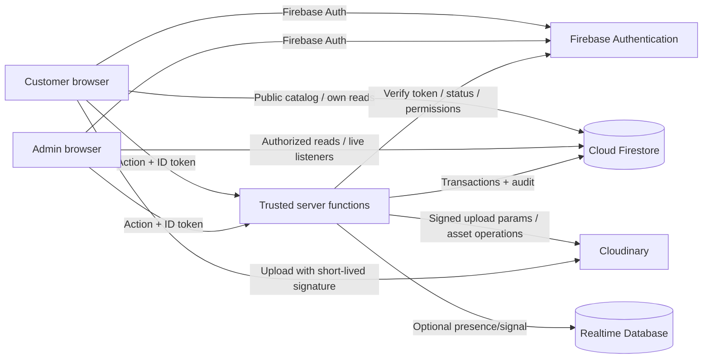
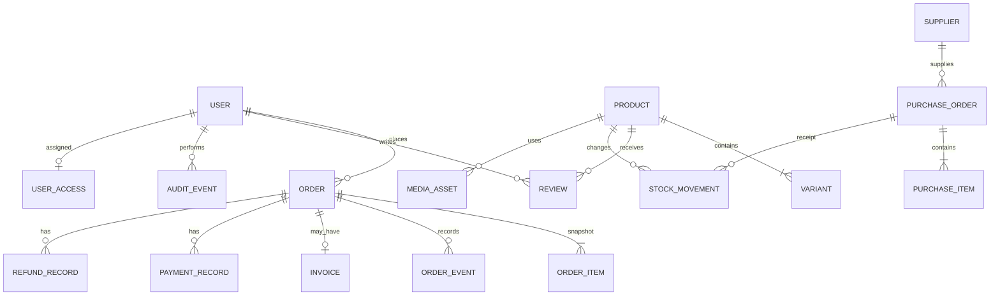
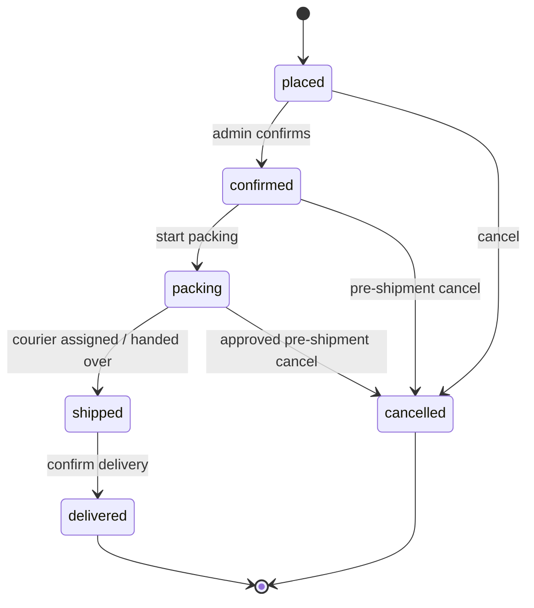

# DIMSGLOW — Technical Architecture and Data Schema

**Status:** Proposed production baseline. Confirm Firebase project settings and the open decisions in `DECISIONS.md` before production setup.

## 1. Recommended technology stack

| Layer | Recommendation | Purpose |
|---|---|---|
| Web | Next.js App Router + React + TypeScript | Storefront, customer portal, admin console, server-rendered public catalog |
| Styling | Tailwind CSS + shadcn/ui + Lucide | Centralized tokens and accessible reusable primitives |
| Forms/validation | React Hook Form + Zod | Typed forms; validate again on the server |
| Identity | Firebase Authentication | Customer/staff sign-in and reset flow |
| Canonical database | Cloud Firestore | All durable catalog, commerce, inventory, finance, CRM and audit records |
| Realtime DB | Firebase Realtime Database | Optional lightweight presence/transient signals only; not duplicate order/catalog state |
| Media | Cloudinary | Product, variant, category, banner and campaign media |
| Trusted business logic | Cloud Functions for Firebase 2nd gen (Node.js 22) and/or authenticated server routes | Privileged order, stock, invoice, payment, role, audit and report actions |
| Charts | Recharts | Admin dashboard visualizations |
| PDF/XLSX | `pdf-lib` (or equivalent maintained PDF library) + `exceljs` | On-demand invoice PDF and secure report export |
| Tests | Vitest, React Testing Library, Playwright, Firebase Emulator Suite | Unit, component, security rules, integration and E2E validation |
| Deployment | Firebase App Hosting for Next.js, subject to region/billing confirmation | Firebase-aligned dynamic application deployment |

Pin compatible stable versions in the lockfile at implementation time. Firebase's official docs describe App Hosting as supporting Next.js and Functions runtimes including Node.js 20/22; select a currently supported runtime and verify deployment prerequisites before resource creation. Firebase App Hosting setup requires a billing-enabled Firebase project, so enable budget alerts and review cost. Sources: [Firebase App Hosting](https://firebase.google.com/docs/app-hosting), [Cloud Functions runtimes](https://firebase.google.com/docs/functions/manage-functions), [Firebase custom claims](https://firebase.google.com/docs/auth/admin/custom-claims), [Cloudinary Upload API](https://cloudinary.com/documentation/upload_images).

### Deployment notes

- Inspect the existing repo before reorganizing it. A monorepo with web and functions packages is a useful target, not a reason to destroy working code.
- Use distinct development/staging/production Firebase projects and Cloudinary folders/presets.
- Confirm supported regions for App Hosting, Firestore, Functions and RTDB in the console. Select regions before creating resources; some locations cannot be changed easily later.
- Use platform secret management or workload identity for server credentials when possible. Never commit a service-account JSON file.

## 2. System boundary




**Trust boundary:** browsers are untrusted. The browser requests an action; trusted server code decides whether it is authorized and valid. The Firebase Admin SDK bypasses Firestore Security Rules, so every Admin-SDK endpoint must independently verify identity, active account, role, permission, input schema and business invariants.

## 3. Suggested repository layout

Use this as a target only after auditing the current repository.

```text
dimsglow/
├── app/
│   ├── (store)/                 # home, collections/[slug], products/[slug]
│   ├── (auth)/                  # sign-in, sign-up, reset-password
│   ├── account/                 # profile, addresses, cart, favorites, orders
│   ├── admin/                   # protected operations shell
│   ├── api/                     # authenticated HTTP routes when needed
│   ├── layout.tsx
│   └── globals.css
├── components/{storefront,account,admin,ui}/
├── lib/
│   ├── firebase/client.ts       # browser SDK, initialized once
│   ├── firebase/admin.ts        # server-only Admin SDK
│   ├── auth/                    # token, session and permission helpers
│   ├── schemas/                 # Zod validation
│   ├── data/                    # typed repositories/read helpers
│   └── utils/
├── functions/src/                # Cloud Functions Gen 2
├── functions/test/
├── tests/                        # unit, rules and E2E tests
├── public/                       # generic UI assets only, not uploaded media
├── firebase.json
├── firestore.rules
├── firestore.indexes.json
├── database.rules.json            # RTDB rules, if RTDB is enabled
├── .env.example                  # names + safe placeholders only
├── package.json
└── README.md
```

Server-only modules must never be imported into client components. Prefer platform identity/default service accounts to downloading admin credentials into the repo.

## 4. Domain model and entity diagram




Firestore is document-oriented; this diagram expresses logical relationships, not SQL foreign keys. Use stable document IDs and explicit reference IDs. Verify referenced records on the server.

## 5. Firestore collection schema

Use Firestore `Timestamp` for dates. Use integer minor units for money, e.g. `pricePaise`, and a currency code such as `INR`; never use floating-point arithmetic for monetary calculations.

| Path | Main fields (indicative) | Access and purpose |
|---|---|---|
| `users/{uid}` | `uid`, `displayName`, `email`, `phone`, `status`, `consent`, timestamps | Owner can read/update allowed profile fields; sensitive fields are server-owned |
| `userAccess/{uid}` | `status`, `role`, `permissions[]`, `createdBy`, timestamps | Server-write only; access control record |
| `products/{productId}` | `slug`, `name`, `description`, `categoryIds[]`, `status`, `pricePaise`, `compareAtPricePaise?`, `currency`, `media[]`, `ratingSummary`, SEO, timestamps | Published catalog can be public; changes go through authorized server endpoint |
| `products/{id}/variants/{variantId}` | `sku`, `options`, optional variant price, `onHand`, `reserved`, `lowStockThreshold`, `active` | Safe variant reads only; stock writes server-only |
| `categories/{categoryId}` | `name`, `slug`, `parentId?`, `sortOrder`, `status`, `imageAsset?` | Published categories public |
| `siteContent/{contentId}` | `type`, `title`, `body`, `media[]`, `link`, `placement`, `sortOrder`, `published` | Home banners, navigation, promos and footer; only published content public |
| `carts/{uid}/items/{itemKey}` | `productId`, `variantId?`, `quantity`, `updatedAt` | Owning user only; server recalculates price at checkout |
| `favorites/{uid}/items/{productId}` | `productId`, `createdAt` | Owning user only |
| `addresses/{uid}/items/{addressId}` | recipient, phone, address lines, city, state, postal code, country, default flag, timestamps | Owning user only; checkout copies a validated snapshot to order |
| `orders/{orderId}` | order number, `customerUid`, customer/address snapshots, item snapshots, subtotal/discount/tax/shipping/total Paise, currency, `status`, `paymentStatus`, `invoiceId?`, courier/tracking, timestamps, idempotency key | Customer read-own; create/transitions/payments server-only |
| `orders/{id}/events/{eventId}` | type, from/to status, actor UID/role, note/reason, timestamp, correlation ID | Append-only by server; safe timeline fields readable by order owner |
| `invoices/{invoiceId}` | order ID, invoice number, `status: active/voided`, issue date, seller/buyer/lines/totals snapshots, void reason, credit-note ref | Private metadata; PDF generated server-side after eligibility check |
| `paymentRecords/{paymentId}` | order ID, amount Paise, state/method/reference, recorder, time, note | Finance/owner; never store card/bank credentials |
| `refundRecords/{refundId}` | order ID, amount Paise, state, reason/method, recorder/time, credit note ref | Finance/owner; manually recorded unless a gateway is approved later |
| `reviews/{reviewId}` | product ID, customer UID, optional order ID, rating 1–5, title/body, moderation status, timestamps | Own eligible review via validated workflow; admin moderation |
| `stockMovements/{movementId}` | product/variant, quantity delta, movement type, reference ID, reason, actor UID, timestamp | Server append-only stock ledger |
| `suppliers/{supplierId}` | name, contacts, optional GSTIN/address/terms, status, timestamps | Inventory/finance authorized users |
| `purchaseOrders/{purchaseOrderId}` | supplier, order number, state, items, expected date, totals, timestamps | Inventory/finance; only recorded receipt changes stock |
| `purchaseOrders/{id}/events/{eventId}` | receiving event, received quantities, actor/time/note | Append-only receipt history |
| `expenses/{expenseId}` | date, category, description, amount Paise, currency, optional supplier/method/reference/attachment, creator | Finance/owner |
| `customerNotes/{noteId}` | customer UID, type, note, tags, creator/time | Support/CRM/owner only; avoid unnecessary sensitive notes |
| `userInvitations/{invitationId}` | normalized email, allowed role/permissions, status, expiry, creator, accepted UID | Server-controlled, single-use invitation flow |
| `auditEvents/{eventId}` | actor UID/role, action, target type/ID, time, correlation ID, safe before/after summary | Append-only; owner/auditor read; never log secrets |
| `dashboardAggregates/{dateKey}` | versioned count/sum fields by date/status/payment state | Server-only derived cache; reconcile with source records |
| `systemSettings/{settingId}` | validated seller, invoice, shipping, currency, tax and policy config | Owner/authorized writes; secrets do not belong here |
| `alerts/{alertId}` | type, entity ID, severity, state, message, created/resolved timestamps | Server-generated low-stock/system alerts |
| `mediaAssets/{assetId}` | Cloudinary `publicId`, `secureUrl`, resource type, folder, alt text, dimensions, uploader, timestamps, state | Server-managed metadata; Cloudinary stores media binaries |

### Data modeling rules

- Orders/invoices contain immutable snapshots so catalog or profile edits do not change historical records.
- Use subcollections for unbounded histories/events; paginate tables with cursors.
- Add composite indexes for actual queries to `firestore.indexes.json` and test them in staging.
- Do not store credentials/secrets in Firestore.
- Keep order events, stock movements, audit events and financial history append-only where possible; only narrow status fields may change through privileged transactions.

## 6. Order lifecycle and consistency model




Do not allow arbitrary status edits from a dropdown without validating the transition. Shipped orders need a recorded return/refund workflow rather than a pretend rollback.

### Inventory lifecycle

1. `placeOrder`: transaction checks `onHand - reserved >= quantity`; increments `reserved`; creates order snapshot + placed event + reservation/movement record.
2. `confirmOrder` / `startPacking`: status changes; reservation remains.
3. `shipOrder`: validate required courier details; decrement `onHand` and `reserved`; create movement and order/audit events idempotently.
4. `cancelBeforeShipment`: release `reserved` exactly once and void/block invoice if applicable.
5. `receivePurchase`: increment `onHand` only for received quantities; an idempotency key prevents double receipt.
6. Returned goods increase stock only after authorized receipt and inspection.

If a transaction exceeds Firestore limits, use an explicit idempotent state machine with retry/reconciliation. Never silently leave stock and order state partially updated.

## 7. Trusted server operation contracts

Every privileged operation must validate ID token, active/non-disabled account, role + exact permission, input schema, referenced records, current business state, idempotency and audit requirements. Derive actor UID from verified identity and return only safe fields.

| Operation | Caller | Input outline | Server guarantees |
|---|---|---|---|
| `placeOrder` | Customer | address ID, cart item IDs/quantities, idempotency key | Recomputes totals, validates/reserves stock once, creates immutable snapshots |
| `transitionOrderStatus` | Order manager/owner | order ID, target status, reason, courier data | Valid transition/permission, stock/invoice effects, timeline + audit |
| `setPaymentStatus` | Finance/owner | order ID, amount, method, reference, state | Appends payment record and updates derived metrics |
| `recordRefund` | Finance/owner | order ID, amount, reason, manual method/reference | Records refund, blocks invoice downloads, preserves history |
| `downloadInvoice` | Owner of order or permitted staff | order ID | Rechecks order/invoice/refund state, streams protected PDF |
| `createCloudinarySignature` | Catalog/content staff | resource type, approved folder, upload params | Chooses allowed folder/type/size; never returns API secret |
| `upsertProduct` | Catalog/inventory permission | validated product/assets | Validates SKU/slug/media refs and audits mutation |
| `adjustInventory` | Inventory/owner | SKU, delta, reason | Appends movement and prevents invalid stock |
| `receivePurchase` | Inventory/owner | PO ID, quantities, idempotency key | Only unreceived quantities increment stock |
| `createExpense` | Finance/owner | date/category/amount/vendor/reference | Validates amount, currency and permission |
| `inviteStaff` / `setUserAccess` | Owner/allowed access manager | email, allowed role/permissions | Server-provisions identity/access; cannot elevate beyond grantable scope |
| `exportSalesReport` | Finance/analyst/owner per policy | date range/grouping/columns | Bounded permission-filtered query; XLSX matches report definitions |

Use callable functions where useful; binary PDF/XLSX downloads may use authenticated HTTPS endpoints for streaming, but still verify session/token and authorization.

## 8. Firebase Authentication and authorization

- Customer identity is Firebase Auth UID. Customer signup never grants staff access.
- Securely bootstrap the first owner; no default credentials or permanent backdoor.
- Keep server-controlled `userAccess/{uid}`. Optional custom claims carry only a small coarse role; exact permissions are checked against current server state.
- After role updates force token refresh where appropriate; revoke refresh tokens when disabling/removing staff. Sensitive server endpoints must check revocation/account state. Do not claim every open browser closes instantly without server checks.
- Admin password reset performed by the owner in Firebase Console changes credentials for new sign-ins; disable/revoke access as appropriate. Customer reset uses the Firebase email/action flow.

## 9. Security Rules strategy

Start with default-deny Firestore and RTDB rules:

- Public: read only published catalog/category/site content safe to expose.
- Customer: read/write only approved fields under own UID; read own orders/events; no direct writes to orders, invoice state, payments/refunds, stock movements, audit, roles, settings, aggregates or purchases.
- Staff: allow only needed reads; sensitive mutations go through authorized server functions.
- Admin SDK: repeat authorization in every server handler because it bypasses Firestore Rules.
- RTDB: default deny; if presence enabled, user can write only their own presence node.

Version control `firestore.rules`, `database.rules.json`, indexes and automated rule tests. Never deploy permissive rules as a shortcut.

## 10. Cloudinary media workflow

1. Authorized staff selects media; UI validates type/size for feedback.
2. Client requests signature from trusted endpoint.
3. Endpoint checks identity and permission, restricts folder (`dimsglow/products`, `dimsglow/categories`, `dimsglow/campaigns`), format, size and transformations.
4. Client uploads over HTTPS using short-lived signed params.
5. Validate response metadata and persist `public_id`, `secure_url`, format/dimensions, alt text, folder and uploader in Firestore.
6. Update/delete is permission-checked and reference-aware; never expose API secret.
7. Public/customer upload is disabled unless a separately approved use case requires it.

## 11. Reporting and aggregates

- Use one shared server report service for on-screen charts and XLSX export; filters/metric definitions must match.
- Distinguish placed order value, confirmed sales, shipped/delivered sales, amount paid, pending balance, cancellations, refunds, expenses, purchases and gross-margin estimates.
- If using daily summaries, update them idempotently by source event and run scheduled reconciliation against source records.
- Configure timezone (owner to confirm; Asia/Kolkata may be appropriate), currency and order/payment/fulfillment date semantics in settings rather than scattering constants.

## 12. Backup and observability

- Define Firestore export/backup strategy appropriate to budget and RPO/RTO; prove restore in staging.
- Export RTDB data/rules if used. Keep app rules/indexes/functions in version control.
- Cloudinary assets need a separate recovery plan; Firestore metadata backups do not include media binaries.
- Log request/correlation ID, function, actor UID, result code and latency, never passwords/tokens/API secrets/payment credentials or unnecessary PII.
- Unsubscribe client listeners on unmount/logout; show loading, stale and error states.

## 13. Official references

- [Firebase App Hosting](https://firebase.google.com/docs/app-hosting)
- [Firestore realtime listeners](https://firebase.google.com/docs/firestore/query-data/listen)
- [Firestore Security Rules](https://firebase.google.com/docs/firestore/security/get-started)
- [Firebase custom claims](https://firebase.google.com/docs/auth/admin/custom-claims)
- [Cloud Functions runtime configuration](https://firebase.google.com/docs/functions/manage-functions)
- [Cloudinary upload API and security](https://cloudinary.com/documentation/upload_images)
