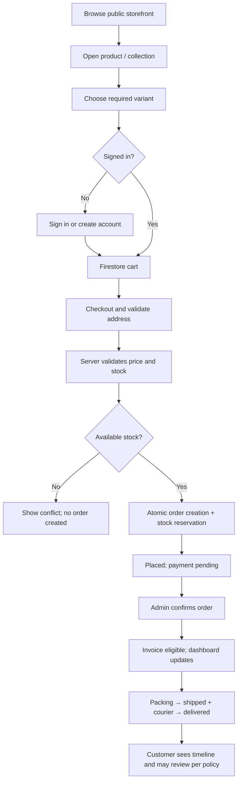
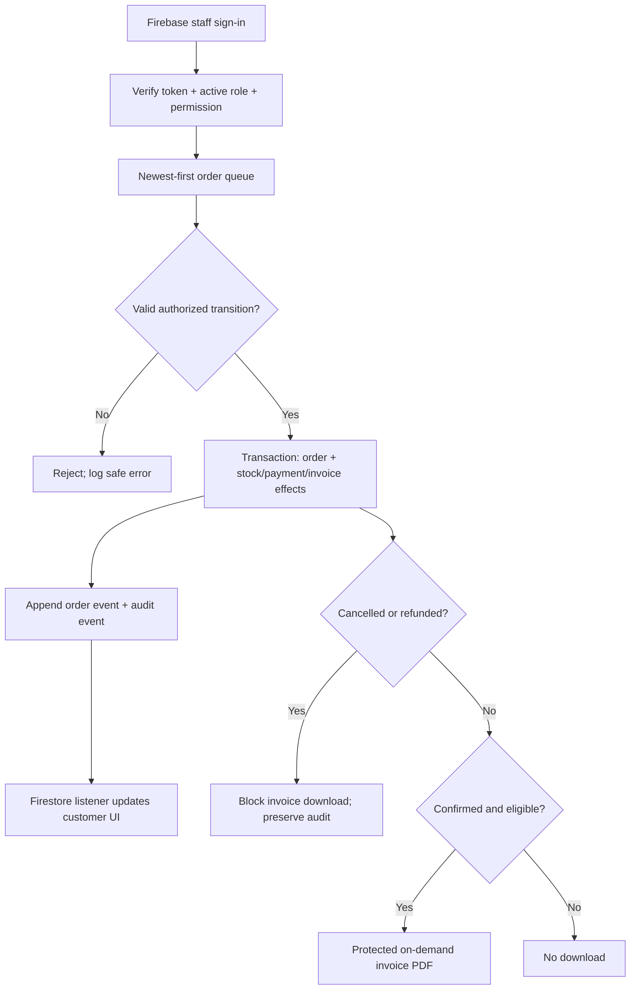

# DIMSGLOW E-commerce Platform — Product Requirements Document

**Version:** 1.0 | **Status:** Build baseline; confirm open business settings before production.

## 1. Product vision

Build a production-oriented DIMSGLOW storefront with layout and interaction patterns based on the supplied 69-page Insight Cosmetics reference PDF. Use DIMSGLOW's own logo, approved brand colors, product copy and licensed assets; do not copy another brand's identity or media without permission.

The platform has three connected surfaces:

1. **Public storefront:** home, collections, search, product pages, about/contact/policies, and sign-in entry points.
2. **Customer dashboard:** profile, saved addresses, persistent cart, favorites, order history, live order tracking, eligible invoice downloads and ratings/reviews.
3. **Admin console:** dashboard, catalog, inventory, orders, invoices, sales, purchases, suppliers, expenses, customers/CRM, reports, user roles, backups, audit and security.

Firebase Authentication provides identity. Firestore is the canonical database for durable business records. Firebase Realtime Database is for lightweight presence/transient signals only if needed. Cloudinary stores product and campaign media. Privileged business mutations run through verified server-side functions/routes, not trusted browser code.

## 2. Business goals

- Let customers discover products and place traceable orders.
- Give the owner a single panel to manage fulfillment, stock, suppliers, purchases, expenses, customer support and reporting.
- Reflect order and shipment changes in customer dashboards without requiring manual refresh.
- Enforce invoice availability based on confirmation, cancellation and refund state.
- Keep real business data dynamic and persisted in Firebase/Cloudinary; never ship fake data or hardcoded records.
- Match the reference layout hierarchy while making it responsive, accessible and branded for DIMSGLOW.

## 3. Initial release non-goals

- No online payment gateway until explicitly selected and approved.
- No courier API integration in v1; admin manually enters courier and tracking details.
- No SQL/other dedicated database.
- No public staff/admin registration.
- No unapproved loyalty, subscriptions, multi-vendor marketplace or automated tax/legal advice.
- No public invoice links or unauthenticated permanent download URLs.

## 4. Personas and permissions

| Persona | Needs | Access boundary |
|---|---|---|
| Visitor | Browse products, collections, search, policies | Public published catalog only |
| Customer | Cart, favorites, order, track, review and invoice download | Own profile/cart/favorites/orders only |
| Owner | Full business operations and user access | Full access, securely bootstrapped |
| Admin | Operate assigned modules | Only assigned permissions |
| Order manager | Process orders, courier and tracking | Orders and necessary fulfillment details |
| Inventory manager | Catalog, SKUs, stock, movements, purchase receipts | Catalog/inventory scope |
| Finance manager | Invoice metadata, payments, refunds, expenses, purchases, reports | Finance scope |
| Support/CRM user | Customer cases, notes, review moderation | Assigned support scope |
| Analyst/read-only | Read permitted reports | No mutations |

Role names and module/action permissions must be configurable. Enforce access on the server and in Firebase rules; hiding a UI button is not authorization.

## 5. Reference UI/UX interpretation

The supplied PDF shows a 69-page Insight Cosmetics desktop storefront capture set, including collection grids, product detail pages, editorial/info sections, FAQs and footers. Reproduce these structural patterns:

- Slim promotional/announcement bar.
- Light header with category navigation, centered logo, and search/account/order-tracking/bag utilities.
- Hero/campaign banners and horizontal promotional sections.
- Collection pages with filters/sort and four-column desktop product grid.
- Image-led cards with optional badge, product title, ratings/review count, price, variant selector and accent CTA.
- Product page with gallery/thumbnails left and purchase panel right, variant swatches, offers, stock/shipping messaging and purchase controls.
- Editorial/help content and multi-column footer.

Use DIMSGLOW assets and content. The Google short URL could not be opened directly in the research browser; the supplied PDF is the reference basis used here. If the URL points to another design, provide a direct URL or screenshots before pixel-level sign-off.

## 6. Functional requirements

### 6.1 Storefront and catalog

- **FR-001:** Public visitors browse published Firestore-backed products and collections.
- **FR-002:** Product details show gallery, name, SKU/variant, price, configured compare-at price, stock, description, rating summary, reviews and related items.
- **FR-003:** Products with variants (size/color/edition/etc.) require option selection before adding the correct SKU to cart.
- **FR-004:** Collection/search pages support pagination, supported filters, sorting and loading/empty/error states.
- **FR-005:** Banners, promo strips, featured collections, navigation and footer links are admin-configurable Firestore content.
- **FR-006:** Product/campaign media comes from Cloudinary; Firestore stores trusted asset references. Broken images have a graceful fallback.
- **FR-007:** Responsive layouts follow `DESIGN.md` on desktop, tablet and mobile.

### 6.2 Authentication and customer area

- **FR-010:** Firebase Auth supports customer sign-up, sign-in, sign-out and reset-password flow.
- **FR-011:** Reset uses Firebase's secure email/action flow; after successful reset the old password fails new sign-in.
- **FR-012:** Admin routes require an existing Firebase Auth identity with active staff access and required permission. No hardcoded admin credentials or client-only role check.
- **FR-013:** Customer dashboard contains profile/address, cart, favorites, recent orders, order history, timeline, eligible invoice actions and reviews.
- **FR-014:** Persistent cart/favorites live in Firestore under the authenticated UID. `localStorage` is not authoritative for customer/business data.
- **FR-015:** Customers can edit only allowed profile fields; never role, order totals, payment, stock, invoice or admin fields.

### 6.3 Cart and checkout

- **FR-020:** Checkout requires a signed-in customer so orders/tracking/invoices are tied to a verified UID.
- **FR-021:** Server re-reads current prices/availability and calculates totals. Browser-submitted totals are never trusted.
- **FR-022:** `placeOrder` is atomic/idempotent: validate stock, reserve it, snapshot items/prices/address and create exactly one order per idempotency key.
- **FR-023:** No payment gateway in v1. Default new-order `paymentStatus` is `pending`; authorized finance/owner staff manually records payment.
- **FR-024:** Successful checkout produces an order confirmation and dashboard order record.

### 6.4 Order lifecycle and live tracking

- **FR-030:** Admin order queue is newest-first by `createdAt`, with date/status/search filters and pagination.
- **FR-031:** Admin can transition through `placed → confirmed → packing → shipped → delivered`, or cancel where allowed. Server validates every transition and writes append-only events/audit.
- **FR-032:** Cancellation requires a reason. Default customer direct cancellation is before shipment; after dispatch, direct cancellation is unavailable and customer follows support/return policy. Owner must approve final policy copy.
- **FR-033:** On shipment, admin manually enters courier, tracking number/URL, ship date and notes; no fake carrier scans.
- **FR-034:** Firestore listener updates the customer timeline/courier details dynamically without manual refresh.
- **FR-035:** Fulfillment `status` and financial `paymentStatus` are separate state fields.
- **FR-036:** Append-only order events contain actor, timestamp, prior/new status, reason and safe metadata.

### 6.5 Invoices, cancellation and refunds

- **FR-040:** Invoice download becomes available only after order confirmation and while the order/invoice remains eligible.
- **FR-041:** Invoice number is generated server-side and collision-safe. Store immutable snapshot of seller/customer details, line items, discounts, configured tax/totals and issue date.
- **FR-042:** Generate invoice PDF through an authorized server endpoint; Firestore stores invoice metadata, not a public download URL.
- **FR-043:** If subsequently cancelled, hide/block customer download and mark invoice `voided`; preserve financial and audit records instead of hard-deleting them.
- **FR-044:** If refunded, hide/block invoice download and record refund/void/credit-note reference as applicable. Owner/accountant must approve GST/accounting treatment; never silently erase a tax document.
- **FR-045:** Every download rechecks order, invoice and refund state server-side; refresh cannot restore an invalid invoice.
- **FR-046:** Seller GSTIN/address, invoice prefix/numbering, place-of-supply, HSN/SAC and tax rates are configurable. Never hardcode rates or promise legal compliance without review.

### 6.6 Inventory and purchases

- **FR-050:** Admin manages product/variant/SKU, images, price, description, category, publish state and low-stock threshold.
- **FR-051:** Show on-hand, reserved and available quantities; `available = onHand - reserved`.
- **FR-052:** Every inventory adjustment has an append-only stock movement with SKU, delta, reference, reason, actor and timestamp.
- **FR-053:** Reserve stock at placement. On shipment decrement on-hand and release reservation. Pre-shipment cancellation releases reservation once. Do not restock shipped/refunded items unless a return is received and inspected.
- **FR-054:** Low-stock alerts trigger at or below configured thresholds.
- **FR-055:** Purchase orders support draft/ordered/partial receipt/received/cancelled. Stock increments only when authorized receiving is recorded.

### 6.7 Finance, CRM, suppliers and reviews

- **FR-060:** Expenses include date, amount, category, vendor, payment reference/method, notes and optional approved attachment.
- **FR-061:** Supplier records include company/contact, optional GST details, terms, status and purchase history.
- **FR-062:** Separate order value, payments collected, pending balance, refunds, expenses and purchase cost; clearly define all KPI labels.
- **FR-063:** CRM contains necessary customer contact/order relationship, tags and safe support notes. Restrict access and avoid unnecessary sensitive notes.
- **FR-064:** Reviews/ratings belong to a user/product, follow a configured eligibility/deduplication policy, and support admin moderation.

### 6.8 Dashboard, analytics and exports

- **FR-070:** Admin dashboard displays real Firestore-backed KPIs/charts, recent orders, low-stock alerts, status pipeline and payment summary with date range/timezone.
- **FR-071:** Reports support weekly, monthly, yearly and custom date intervals.
- **FR-072:** Generate XLSX exports on the server with the same filters/permissions/definitions as the UI.
- **FR-073:** Report definitions specify timezone, currency, handling of cancel/refund, taxes/discounts and whether metrics are keyed by order, payment or fulfillment date.
- **FR-074:** Any derived aggregate is idempotently updated and reconciled against source records. Never hardcode chart values.

### 6.9 Roles, backup and audit

- **FR-080:** Owner can provision additional authorized users and grant limited permissions through a secure server-side workflow connected to Firebase Auth.
- **FR-081:** No public staff signup, client-side role selector or direct client writes to roles/permissions.
- **FR-082:** Customers use self-service reset. Per owner preference, admin resets/recovery are performed by the owner in Firebase Console, with backend revocation/disable handling where needed.
- **FR-083:** Sensitive admin mutations write audit events with actor/action/target/time/correlation ID and safe before/after details.
- **FR-084:** Document and test backup/restore for Firestore, RTDB/rules and Cloudinary asset recovery. Backup is not complete until restore succeeds.

## 7. Main customer order flow

### Admin order and invoice flow

## 8. Core rules

1. Firestore is canonical; UI state/caches are not authoritative.
2. Customer ownership is determined by verified Firebase UID, not client-supplied UID alone.
3. Order/stock operations are transactional/idempotent; retries cannot duplicate orders or stock changes.
4. Price, total, tax, invoice number, roles and payment changes are server-derived/authorized.
5. `status` and `paymentStatus` remain separate.
6. Recheck invoice eligibility on every download.
7. Hide invalid invoices but retain accounting/audit trail.
8. Courier tracking is manually maintained in v1.
9. No gateway without a recorded accepted decision.
10. Production UI uses Firestore records and Cloudinary assets only; fixtures are emulator/test-only.

## 9. Launch acceptance criteria

- Customer can authenticate, browse, persist cart/favorites, order, see live status and download only eligible invoices.
- Backend functions and security rules reject non-admin users even if they change URLs/client state.
- Admin can process an order through delivery; customer updates without refresh.
- Cancel/refund blocks downloads and keeps audit history.
- Stock reserve, shipment deduction, cancellation release and purchase receipt remain consistent under retries/concurrency.
- Reports and XLSX exports reconcile to source records.
- No exposed secrets, hardcoded private data, default credentials or unauthenticated invoice URLs.
- Backup/restore is demonstrated in a non-production project.

## 10. Owner decisions required

- DIMSGLOW logo/brand guide/product taxonomy/copy/approved photography and campaigns.
- Legal seller name/address/GSTIN, invoice settings, tax/place-of-supply rules and accountant approval.
- Payment methods displayed (no gateway for v1), payment proof/reference and roles allowed to mark paid.
- Shipping zones/cost/serviceability/delivery estimate/courier fields.
- Customer cancellation cutoff, return/refund policy and credit note treatment.
- Review verification/moderation policy and admin permission matrix.
- Production Firebase region, Cloudinary cloud/presets, deployment domain, email configuration, retention and budget alerts.

## 11. Related documents

`ARCHITECTURE.md` — stack/data model; `DESIGN.md` — UI/UX; `RULES.md` — coding-agent constraints; `TASKS.md` — implementation phases; `DECISIONS.md` — decision log; `MEMORY.md` — persistent facts; `TEST_PLAN.md` — tests/release gates; `SECURITY.md` — security/runbook.
